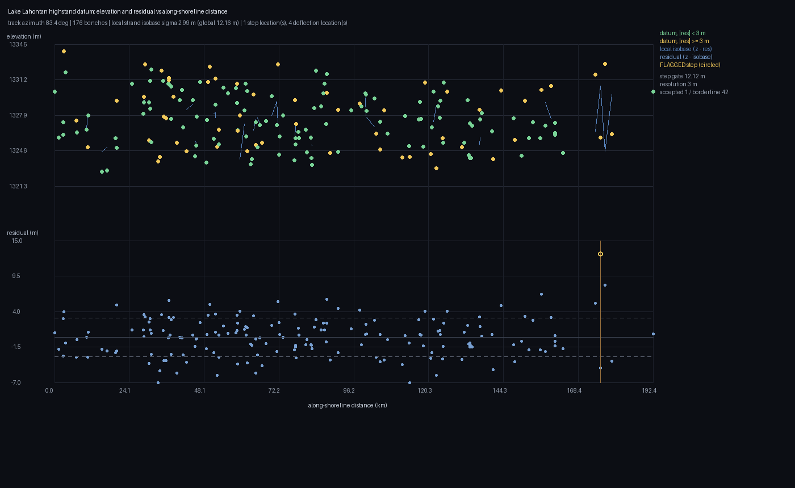

# Executive summary — **NO: do not submit the historical TIF**

## ⛔ Unmistakable verdict

**NOT CLEARED for competition submission. Do not spend a slot.** The file at
[`downloads/gemsdoe62-datum-lahontan-isobase-v8.tif`](downloads/gemsdoe62-datum-lahontan-isobase-v8.tif)
is retained as an archival learning artifact only. It is not a new candidate, it fails the strict
registry gate, and it fails the current local outside-footprint format check.

### Why it is stopped

1. **Strict registry stop.** The historical raster has 1,660 positive dots. **1,601** are within
   Euclidean 3 px (fraction **0.964458**) of the fetched `13GEMSDOE` `r11-greedy-mp-v2` comparator
   (272,853 positives); the literal threshold is more than 0.70. Rank rho to that comparator is
   −0.331789, below the 0.90 ceiling. The overlap alone returns **`DUPLICATE-STOP`**. The fail-fast
   scan stopped after 9 of 525 fetched TIFFs; comparator coverage is diagnostic only and does not
   waive the raw-overlap rule.
2. **Format failure.** The file is single-band `float32`, EPSG:32611, 3730×3292, 100 m, with the
   expected transform and bounds; in-footprint values are finite and in `[0,1]`, with no nodata
   tag. But it has **7,111,787 non-NaN cells outside the footprint**. The official submission
   description allows/requests null/NaN outside, and the local checker correctly returns
   `legal: false` (`all_nan_outside_footprint` failed).
3. **No new emission.** A corrected shared writer now writes NaN outside the footprint and checks
   the written bytes. No replacement TIF was emitted after the strict duplicate stop. The old
   file was not silently repackaged as a new submission.

The registry fetch saved 525 GeoTIFFs from 88 repositories; 12 repositories exceeded the 90 MB
archive cap and were skipped. This is not an exhaustive uniqueness clearance. The single
independently reproduced strict failure is already sufficient to stop.

## Evidence, with classes

| item | result | evidence class / limit |
|---|---|---|
| Local holdout | `0.002863` DTI; 95% spatial-block bootstrap CI `[0, 0.006842]`; 60,362 withheld positive catalogue cells | **HOLDOUT-DTI**, evaluator `root-run_holdout-v3`, 6 spatial blocks; catalogue proxy, not an organizer score |
| Feature-alone leakage canary | AUC 0.5020 (`lane_kernel_proximity`); 0.4999 (`lane_binary_mask`) | **HOLDOUT-DTI canary**, both below the 0.90 alarm; no canary alarm, not proof against every leakage mode |
| Registry comparator | rank correlation −0.3318; raw 3 px overlap 0.9645 (1,601/1,660) | **LOCAL-STRICT-REGISTRY-CHECK**, first blocking comparator in fail-fast scan; overlap exceeds 0.70, so stop |
| Format validator | `legal: false`; failed check `all_nan_outside_footprint` | **LOCAL-FORMAT-CHECK**, not an organizer verdict |
| Organizer score / receipt | none | **No ORGANIZER-CONFIRMED result exists** for this artifact |

The holdout truth is the USGS/INGENIOUS catalogue. The competition target is faults absent from
that catalogue, so this proxy cannot establish performance on hidden new faults. It is presented
only as a bug/leakage diagnostic. The historical score claims recorded elsewhere in this repo
remain claims, not organizer receipts.

## Datum-offset hypotheses for a future run

The assigned lane remains Lake Lahontan shoreline-datum displacement; no other lane is proposed.
The ranked, untried variants and their distinct physical signatures are in
[`hypotheses.md`](hypotheses.md). In short: multi-strand displacement coherence, strand-specific
isobases with piecewise-kink residuals, matched lateral offsets across separated shorelines, and
paired shoreline/paleochannel displacement; the initial screens use the cached 25 m DEM.
No submission slot is recommended until a candidate passes a spatially blocked holdout and both
strict registry checks. A local catalogue holdout cannot validate hidden-fault novelty.

## Shoreline profile and source caveat

The figure below is an **earlier 99-dot exploratory profile**, not the v8 raster reviewed above.
It shows the old run's 176 selected benches, local strand isobase residual, and one flagged step;
its source data receipt is [`evidence/gems62-lahontan-isobase-99dots-profile.json`](evidence/gems62-lahontan-isobase-99dots-profile.json), and the rendered asset is [`assets/profile.png`](assets/profile.png).
The v8 run's detailed per-bench profile arrays were not retained, so this figure must not be
attributed to v8 or used as validation for the stopped raster.

**Scientific/source links for manual review:**

- [Official competition metric and submission format](https://www.drivendata.org/competitions/306/competition-doe-gems/page/967/) — 300 m triangular distance kernel, DTI weights, single-band `float32` requirements, null/NaN outside the footprint.
- [Official competition rules (FY26 OSTI 96647 PDF)](https://docs.nlr.gov/docs/fy26osti/96647.pdf) — weekly submission cap and required AI-use disclosure; Phase 2 involves expert review.
- [USGS 3DEP TNM product discovery API](https://tnmaccess.nationalmap.gov/api/v1/products) — official source for elevation/LiDAR product discovery. The sandbox could not reach USGS hosts; the existing 25 m DEM was transported through a GitHub runner.
- [Dong et al. (2014), *Geosphere*](https://pubs.geoscienceworld.org/gsa/geosphere/article/10/1/40/132152/Strike-slip-faulting-along-the-Wassuk-Range-of-the) — Lake Lahontan shoreline displacement in Walker Lane context.
- [Pierce, Wesnousky & Owen (2016), SCEC Contribution 6917](https://www.scec.org/publication/6917) — lidar-based faulted fans, stream offsets, and unmapped structures in the northern Walker Lane.
- [Pierce et al. (2021), *Tectonics*](https://agupubs.onlinelibrary.wiley.com/doi/full/10.1029/2019TC005612) — Walker Lane tectonic context.
- [Adams, Wesnousky & Bills (1999), DOI](https://doi.org/10.1130/0016-7606(1999)111%3C1739:IRAFAP%3E2.3.CO;2) — Lake Lahontan isostatic rebound and geomorphic effects.

## Reproducibility and review record

- Machine-readable negative run card: [`evidence/lahontan_run_card_20261011.json`](evidence/lahontan_run_card_20261011.json).
- Strict uniqueness receipt: [`evidence/uniqueness_v8_strict_review.json`](evidence/uniqueness_v8_strict_review.json).
- Full local format receipt: [`evidence/v8_format_review.json`](evidence/v8_format_review.json).
- Recomputed holdout and leakage canary: [`evidence/holdout_v8_strict_review.json`](evidence/holdout_v8_strict_review.json).
- Three review passes and remaining work: [`irregularities.md`](irregularities.md).
- Root unit/regression suite after shared-tool changes: **28 passed** (local code tests; not scientific or organizer validation).

**Decision: `negative`.** No slot was selected, no submission was placed, and no organizer result is claimed.
