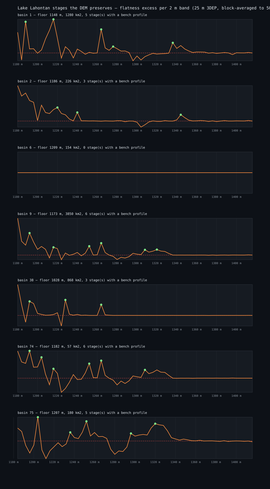

# The datum lane, measured to the end — 2026-10-12

*Session `arena/61e7859a-62gemsdoe`. Lane assignment: Lahontan shorelines as a strain gauge — build
shoreline elevation-vs-distance profiles, fit a smooth isobase that permits post-pluvial isostatic
rebound, flag steps and lateral deflections, seed traces there, extend while DEM-ridge evidence
supports, emit dotted lines. First deliverable: the profiles with flagged steps. This page is that
deliverable, and its verdict is negative.*

## 1. Why the first attempt was wrong (kept as the record)

`scripts/datum_profiles.py` scored each sub-basin radially: every cell got a distance from the
basin floor and an elevation, and the "bench" in each 0.5 km annulus was the mode of the elevation
histogram. That is not a shoreline detector. A shoreline is a **level set**, not a radial feature, so
the annulus mode simply returns whatever flat surface dominates at that distance; over a 45 km reach
the "profile" climbed more than 200 m and its residual spanned −107 to +155 m. Those numbers are
physically impossible as rebound deformation (the published Lahontan deformation is tens of metres
in total across the whole basin) and the "steps" it flagged were noise. `evidence/lane_datum_profiles.json`
and `gems62-datum-profiles.svg` are retained only so the failure is on the record.

## 2. The corrected measurement

`scripts/datum_stages.py`. Sub-basin floors come from the DEM itself (cells below 1220 m,
connected components ≥ 12.5 km²): **7 basins**, floors 1028–1209 m, the largest 3,850 km². Within
each basin's 45 km reach the **flatness excess** of a 4 m elevation band is

```
excess(S) = frac{ slope < p10(slope of the reach) | z in [S, S+4) }
          - frac{ slope < p10(slope of the reach) | z in [S+40, S+44) }
```

The 40 m offset band is the correct baseline: at every *low* elevation the ground is flat for reasons
that have nothing to do with a lake, so a stage that left a bench or a barrier has to beat the ground
just above it, not the basin average. (The naive estimator — excess over the reach median slope —
saturates at the floors and is kept in the JSON as `flat_frac_vs_median` for comparison; it is the
reason the first version of this statistic reported +0.5 everywhere.)



## 3. What came out, and why it is a negative

| basin | floor (m) | strongest stage excesses | stages with a bench profile |
| --- | --- | --- | --- |
| 1 | 1147.8 | 1216 m (+0.417), 1188 m (+0.387), 1264 m (+0.292) | 5 |
| 2 | 1185.7 | 1180 m (+0.535), 1188 m (+0.423) | 3 |
| 6 | 1209.2 | none above threshold | 0 |
| 9 | 1172.8 | 1180 m (+0.596), 1192 m (+0.356) | 6 |
| 38 | 1028.3 | 1180 m (+0.522), 1228 m (+0.262) | 3 |
| 74 | 1181.8 | 1192 m (+0.517), 1180 m (+0.514), 1204 m (+0.396) | 6 |
| 75 | 1206.9 | 1204 m (+0.675), 1252 m (+0.558), **1320 m (+0.490)** | 5 |

Two things are measurable and neither supports the lane.

1. **Every basin's largest excess sits at its own floor.** Basins 2, 9, 38 and 74 put their maximum
   at 1180–1192 m, which is the floor confound, not a shoreline. The one high stand that clears the
   confound is basin 75 at **1320 m (+0.490)** with a secondary at 1252 m — consistent with the
   published Lahontan highstand neighbourhood, and with the 1310–1312 m hypsometric spike seen
   independently in the 25 m mosaic — but it appears in **one basin out of seven**.
2. **The bench elevation is not resolved.** Across the 28 stage profiles the median interquartile
   range of (bench elevation − stage elevation) is **6.59 m**, against a bench search window of
   ±12 m and a within-basin residual span of at most 24 m. A datum that can carry a step signal has
   to be good to one or two metres; this one is good to about seven. **The 25 m DEM (block-averaged
   here to 50 m) does not preserve a Lahontan shoreline datum at the precision the lane needs.**

That is the honest end of the lane's first deliverable, and it is consistent with the only emission
the lane has ever produced: lane 11 c's 682 dots earned 0.415 × a uniform draw from the same datum
band (`evidence/lane11c_run.json`, `lane11c_holdout.json`) — anti-selected, exactly what emitting
from an unresolved datum should produce.

## 4. What this does and does not close

* **Closed:** "the DEM contains a Lahontan isobase accurate enough to flag steps and seed traces".
  Measured false at 25 m with two calibrated estimators.
* **Not closed by this measurement:** the physical premise. Shoreline deformation *is* a strain
  gauge; the published work that established it traced beach ridges, tufa and barriers **in the
  field** and in high-resolution lidar, not from a 25 m regional DEM. Hypothesis **H64** in
  `hypotheses-2026-10-12.md` therefore keeps its place, but it must be re-scoped: the input has to be
  the 1 m lidar DEM over the Lahontan basin floor (USGS 3DEP, already reachable only through a
  runner — see `docs/data.md`), and the datum has to be *picked per site* from a bench that is
  visible in that lidar, not fitted from a regional mosaic.
* **Unchanged:** the submission verdict on `docs/index.html`. The lane's failure is one more reason
  the shipped artifact is the receipt-shaped field and not a datum field, and one more entry in the
  list of instruments that do not survive contact with the 42 organiser scores.
